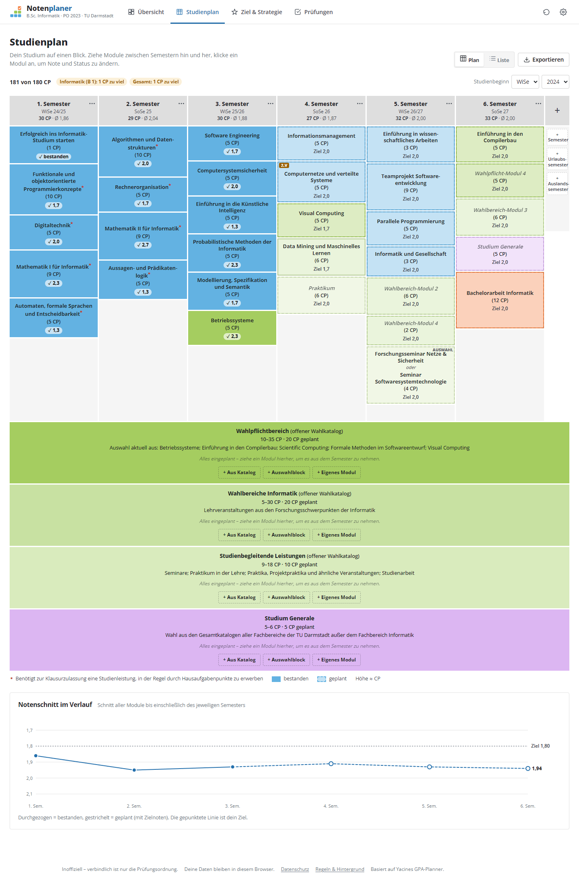
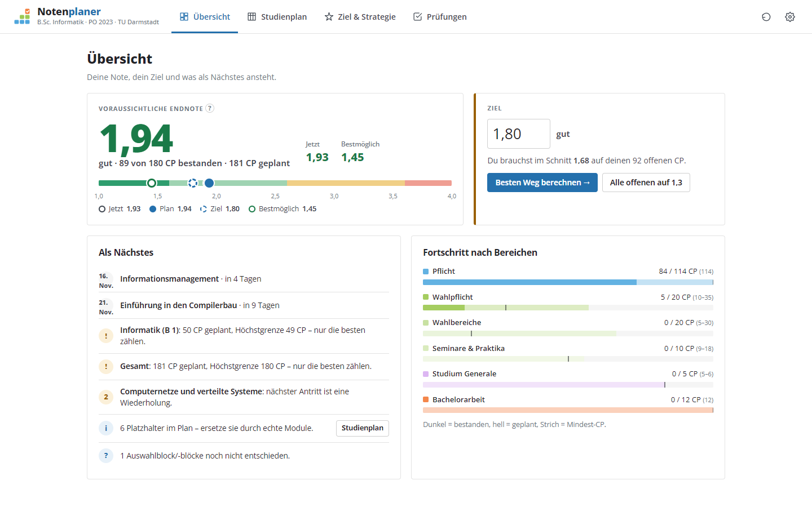
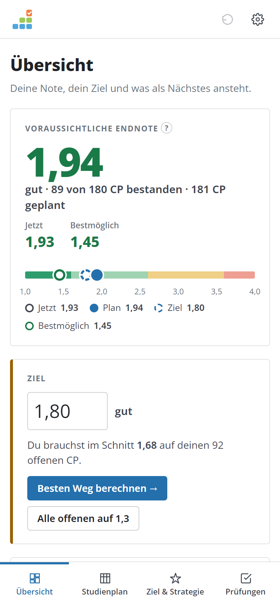

# Notenplaner — B.Sc. Informatik (PO 2023), TU Darmstadt

A grade and study planner for the B.Sc. Informatik at TU Darmstadt. It computes your
**Gesamtnote the way the Prüfungsordnung defines it**, lays out your whole degree as an interactive
version of the official *Studienübersicht*, and tells you what you still need for your goal.

**Open it:** https://yacine-dh.github.io/GPA-Planner-B.Sc.-Informatik-2023-TU-Darmstadt/

No account, no server, no tracking. Everything stays in your browser.



## What it does

| | |
|---|---|
| **Studienplan** | The official overview, made interactive. Modules are colored by area (Pflicht, Wahlpflicht, Wahlbereiche, Seminare & Praktika, Studium Generale, Bachelorarbeit) and shown solid when passed, dashed when planned. Drag modules between semesters, use **+** for a 7th or 8th semester, and mark a semester as **Urlaubssemester** (blocked, doesn't count as a Fachsemester) or **Auslandssemester** (your own modules, recognized into an area). **Choice blocks** hold "Seminar A *or* B" until you decide. The elective bands hold not-yet-scheduled modules, and there is a 270-module catalog from the Modulhandbuch. Export as PNG or PDF. |
| **Grade over time** | Running average per semester, passed vs. planned, against your goal. |
| **TUCaN import** | Drop the Leistungsspiegel PDF from TUCaN's print button. Modules, CP, grades, open modules, Schwerpunkte and seminar/lab types are recognized. Parsed locally with pdf.js. |
| **Ziel & Strategie** | The average you need, plus an **optimizer** that finds the least-effort grade plan based on how hard each module is for you. It shows what one extra elective would do (§ 25 (5) caps) and which modules to **deselect instead of retake**. **Scenarios** (copy / optimistic / pessimistic) compare plans side by side. |
| **Prüfungen** | Exam dates with countdown, failed attempts (3 per exam), the once-per-degree *mündliche Ergänzungsprüfung* (§ 32), and the **Abwahl budget**: § 30 (5) once per area, § 30 (6) unlimited. |
| **Rule checks** | Every area within its CP range, 180 CP total, and the B 1.2 rules (≥ 1 Seminar, ≥ 1 Praktikum, ≤ 1 Praktikum in der Lehre, ≤ 1 Studienarbeit). |
| **Everything else** | German / English, light / dark, works on phones, works offline and installable (PWA), undo (Ctrl+Z). |

<p> </p>

## The formula

```
Gesamtnote = Σ (CP_i × Note_i) / Σ CP_i     →  keep 2 decimals, truncate, no rounding
```

| Rule | Source |
|---|---|
| Weight = CP; no module has a bonus factor, the 12 CP thesis included | Studiengangsordnung *zu § 28 (2)*, Anhang I |
| Pass/fail modules excluded | APB § 25 (1) |
| In elective areas the best grades count up to the area's cap, partial CP included | APB § 25 (5) |
| Truncate to 2 decimals | APB § 28 (2) |

Caps per area (printed on every Leistungsspiegel) are applied bottom-up: Wahlpflicht 35 · Wahlbereiche 30 ·
Fachprüfungen 40 · Studienbegleitende Leistungen 18 · Informatik 49 · Studium Generale 6 CP.
TUCaN's *Gesamt-GPA* is a forecast with estimates, so mid-degree it differs from this value. The
*Regeln & Hintergrund* page in the app explains why, along with retakes, deselection and leave semesters.

## Your data

- Stored only in this browser's `localStorage`. Nothing is uploaded, the app makes no third-party requests, and the PDF import runs locally.
- **⚙ → Backup exportieren / importieren** moves your plan between devices. Backups from the original single-file planner can be imported too.
- **⚙ → Alle Daten löschen** wipes everything. The app reminds you to back up if you haven't in 30 days, and asks the browser for persistent storage so it isn't evicted silently.
- Hosted on GitHub Pages, so GitHub processes visitors' IP addresses (see the in-app *Datenschutz* page).

## Run locally / host it

Double-click `index.html`; it works from disk. To host it, enable **GitHub Pages → Deploy from a branch →
`main` / root**. There is no build step, and `.nojekyll` makes Pages serve the files as they are. Over http(s) a service
worker caches the app for offline use. Bump `VERSION` in `sw.js` when you change the file list.

```
index.html, css/, js/      the app (plain scripts, no build)
js/engine.js               § 28 calculation, solver, optimizer, structure checks
js/tucan.js                Leistungsspiegel import (PDF + pasted text)
js/store.js                state, scenarios, semesters, persistence, undo
js/views/*.js              Übersicht, Studienplan, Ziel & Strategie, Prüfungen, settings
js/catalog.js              elective catalog, generated by tools/extract_catalog.py
vendor/                    pdf.js 3.11.174 (Apache-2.0), html-to-image 1.11.11 (MIT), loaded on demand
css/fonts.css              Open Sans (OFL, see fonts/OFL.txt), embedded so it also works from file://
docs/                      the official TU Darmstadt documents this is built from
legacy/gpa.html            the original single-file planner, unchanged
```

Rebuild the catalog after a new Modulhandbuch:
`pip install pymupdf && python tools/extract_catalog.py docs/Modulhandbuch_BSc_Informatik_PO2023.pdf js/catalog.js`

## Sources

[APB (Satzungsbeilage 2023-VII)](https://www.intern.tu-darmstadt.de/media/dezernat_ii/ordnungen/apb.pdf) ·
[Studiengangsordnung B.Sc. Informatik 2023](https://www.informatik.tu-darmstadt.de/media/informatik/fb20_studium/formulare_und_dokumente/ordnungen/ordnungen_bsc/pruefungsordnung_2023/Studiengangsordnung_Bachelor_Informatik_2023.pdf) ·
[Studien- und Prüfungsplan](https://www.informatik.tu-darmstadt.de/media/informatik/fb20_studium/formulare_und_dokumente/ordnungen/ordnungen_bsc/pruefungsordnung_2023/SPP_B.Sc._Informatik.pdf) ·
[Modulhandbuch](https://www.informatik.tu-darmstadt.de/media/informatik/fb20_studium/formulare_und_dokumente/ordnungen/ordnungen_bsc/pruefungsordnung_2023/2022_09_30_MHB_BSC_INF.pdf) ·
[TUCaN FAQ](https://www.tu-darmstadt.de/studieren/studierende_tu/studienorganisation_und_tucan/hilfe_und_faq/artikel_details_de_en_32704.de.jsp).
Copies live in `docs/`; the linked originals are authoritative.

## Credits & disclaimer

Original planner and grade rules by **Yacine** (`legacy/gpa.html`). Study plan, import, optimizer, exams,
redesign and hosting by **Amine Cheikhrouhou**.

Unofficial, not affiliated with TU Darmstadt. The Prüfungsordnung is the only binding source. If a
number here matters to a decision, check it with your Studienbüro.
